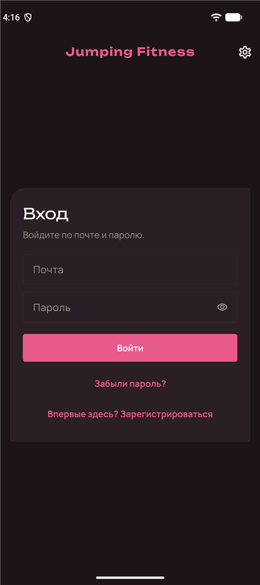
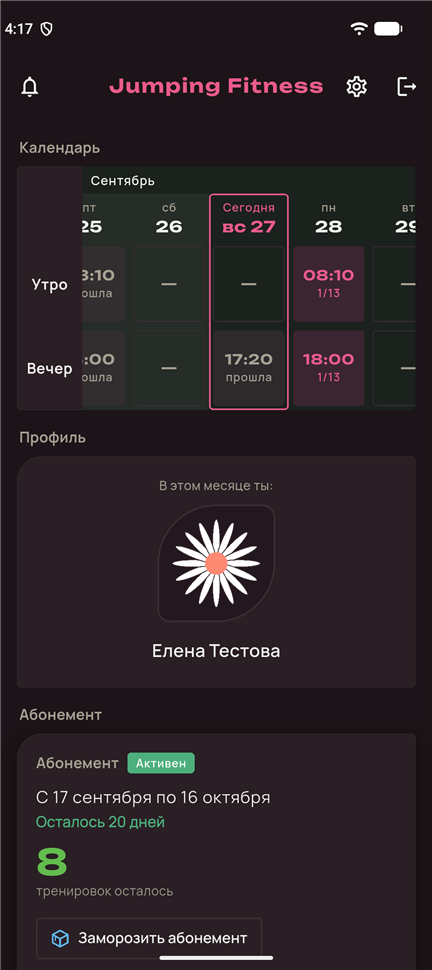
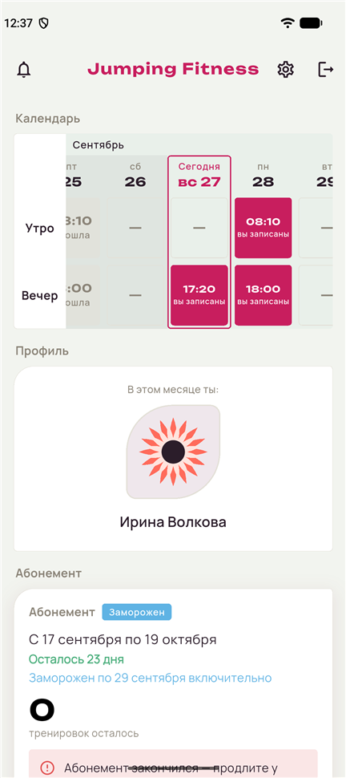
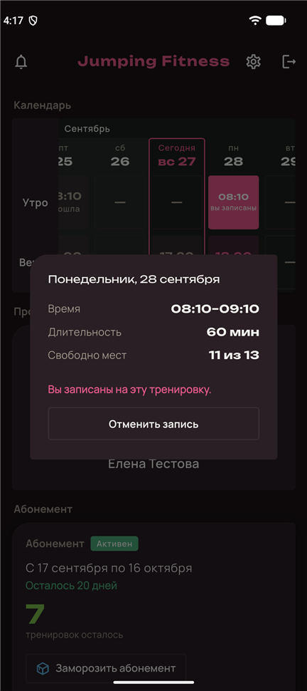
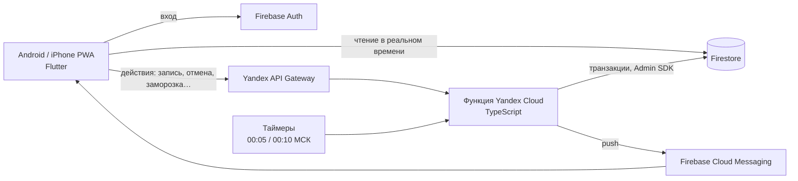

# Jumping Fitness

Мобильное приложение для студии групповых тренировок: запись на занятия, учёт абонементов,
расписание тренера и уведомления. **Работает в студии** — Android-приложение и веб-версия
для iPhone, около 20 пользователей.

*A booking & membership app for a fitness studio: Flutter (Android + iOS web app), Firebase,
serverless business logic on Yandex Cloud. In production use.*

  
  
  
  

## Возможности

**Клиент**
- Календарь занятий (утро / вечер) с числом свободных мест, запись и отмена в один тап
- Отмена не позже чем за 3 часа до начала; причина, почему действие недоступно, — под значком (i)
- Абонемент: срок, остаток тренировок со шкалой цвета, заморозка на N дней, баннеры «скоро закончится»
- «Цветок месяца» в профиле — без повторов три месяца подряд

**Тренер**
- Общий календарь: создание, перенос и отмена тренировок, список записавшихся, удаление клиента
- Клиенты: поиск, сортировка по остатку, продление абонемента
- При отмене или переносе — автоматический возврат тренировок и уведомления записанным

**Администратор** — рассмотрение заявок в тренеры (роль выдаётся только сервером).

**Везде** — push-уведомления с переходом к нужной тренировке, история уведомлений,
светлая / тёмная / системная тема, вход по почте с подтверждением.

## Стек

| Слой | Технологии |
|---|---|
| Клиент | **Flutter 3.47 / Dart 3.13**, Riverpod 3, Material 3, собственная дизайн-система |
| Платформы | Android (APK), **iPhone — PWA** (Flutter Web на экране «Домой», веб-push iOS 16.4+) |
| Данные | **Firebase**: Firestore, Authentication (email + подтверждение), Cloud Messaging, Hosting |
| Бизнес-логика | **TypeScript** serverless-функции: Yandex Cloud Functions + API Gateway + Lockbox, таймеры |
| Безопасность | Firestore Security Rules — клиенту разрешено только чтение своего и три узкие записи |
| Качество | 150+ тестов Flutter, 70+ тестов сервера на эмуляторах Firebase, 46 тестов правил |

## Архитектура

- **Вся строгая логика — на сервере.** Приложение только показывает данные и просит действие;
  места, списание тренировок, сроки и роли меняет функция в одной транзакции. Одновременные
  нажатия не дают «14 из 13» и не списывают тренировку дважды; правила Firestore не дают
  обойти сервер прямой записью.
- **Один код — две площадки.** Функции написаны как Firebase callable; тонкий адаптер
  переводит HTTP-запросы и таймеры Yandex Cloud в тот же вызов, поэтому весь набор тестов
  прогоняется и в эмуляторе Firebase, и через адаптер.
- **Время — только серверное**, «сегодня» — по Москве; ночная задача сжигает тренировки
  истёкших абонементов и рассылает напоминания (идемпотентно — повторный запуск безопасен).

## Инженерные решения, которыми я доволен

- Перенос бизнес-логики с Firebase Cloud Functions на **Yandex Cloud** без переписывания:
  адаптер протокола callable, CORS для веба, API Gateway (прямой вызов функции
  перехватывал заголовок `Authorization`), секреты в Lockbox, таймеры вместо Cloud Scheduler.
- **PWA вместо App Store** для iPhone: запрос разрешения на push только по жесту пользователя
  (требование Safari), подсказка «добавьте на экран Домой», отдельный service worker для FCM.
- Отказы сервера несут машинную причину (`details.reason`) — клиент показывает понятный
  текст под значком (i), не дублируя правила у себя.
- Тесты Security Rules и функций на локальных эмуляторах Firebase, включая гонки
  (последнее место при одновременной записи получает ровно один).

## Документация

- [docs/DEVELOPMENT.md](docs/DEVELOPMENT.md) — запуск, локальные эмуляторы, структура кода
- [docs/02_firestore_schema.md](docs/02_firestore_schema.md) — схема данных и правила доступа
- [docs/04_cloud_functions.md](docs/04_cloud_functions.md) — серверные функции, проверки, причины отказов
- [docs/08_test_checklist.md](docs/08_test_checklist.md) — чек-лист тестирования
- [ИНСТРУКЦИЯ_ПО_ЭКСПЛУАТАЦИИ.md](ИНСТРУКЦИЯ_ПО_ЭКСПЛУАТАЦИИ.md) — развёртывание и сопровождение

## Лицензия

© 2026. **Все права защищены.** Код опубликован только для ознакомления — копирование,
изменение и использование без письменного разрешения автора запрещены. См. [LICENSE](LICENSE).
